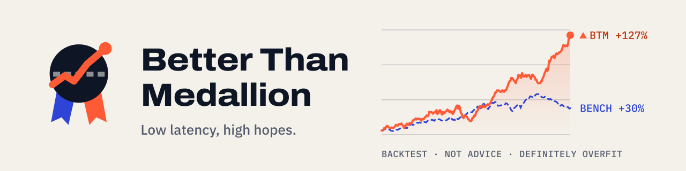
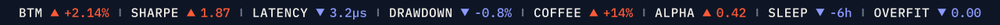

# Better Than Medallion: brand kit

## Concept

Better Than Medallion is a group of friends learning systematic trading, with the hot path in Rust and C++, research in Python and dashboards in TypeScript. The name is a joke we are in on: we are nowhere near the most famous fund in the business, and we say so with a straight face. The identity takes the joke seriously enough to look competent. It should read as a small, sharp quant shop that ships good code and does not take its own backtests too seriously.

The reference to that fund lives **only in our name**. We never use another firm's logo, wordmark, colours or typography, and we never imply any affiliation.

## The mark

 

A **medal with ribbon tails**, with our equity curve drawn across it:

- A dashed line crosses the disc: the **benchmark**.
- The persimmon **equity curve** starts below the benchmark, takes a drawdown, crosses the benchmark and **breaks out through the medal's edge**, ending on a filled dot (the last print).
- The two **ribbon tails** carry the market pair: cobalt on the benchmark side, persimmon on ours.

The idea in one line: the medal is the benchmark, and the curve doesn't stay inside it. The breakout through the rim is what makes the mark recognisable, so it must never be cropped or contained.

It is built on a 64-unit grid. Every stroke and gap is at least 3 units, so it stays legible at 32 px (GitHub avatar, favicon) and still reads as "medal + zigzag" at 16 px.

| File | Use |
| --- | --- |
| `logo-mark.svg` | Mark for light backgrounds (ink disc), transparent |
| `logo-mark-dark.svg` | Mark for dark backgrounds (paper disc), transparent |
| `avatar.svg` / `avatar.png` | 500×500 org avatar, ink background, mark inside the central ~70 % (safe for circle and rounded-square crops) |
| `banner-dark.svg` / `banner-light.svg` | 1280×320 profile README header |
| `social-preview.png` | 1280×640 repository social card (Settings → Social preview) |
| `divider.svg` | 1280×32 ticker-tape strip between README sections |

All text in the SVGs is converted to paths, so they render identically on GitHub, which displays README SVGs as images without web fonts.

## Palette

The market pair is **persimmon and cobalt** instead of the usual red and green. The two can be told apart with every common form of colour blindness, and they don't look like a crypto exchange.

Convention in every chart and dashboard: **persimmon = up / bid / our P&L**, **cobalt = down / ask / benchmark**. Orange-red for "up" deliberately follows the East Asian market convention, and it keeps our own line in the warm hero colour.

| Token | Hex | Role |
| --- | --- | --- |
| Ink | `#0E1626` | Primary dark neutral: text on light, background on dark |
| Ink 2 | `#1A2438` | Raised surfaces on ink (cards, code blocks) |
| Paper | `#F4F1EA` | Primary light neutral: background on light, text on dark |
| Paper 2 | `#E6E1D6` | Rules and surfaces on paper |
| Slate | `#6B7385` | Gridlines, separators, secondary UI |
| Persimmon | `#FF5A36` | Up / bid / our strategy. Graphics on both modes, text on ink |
| Persimmon text | `#C2360F` | Persimmon for text on paper |
| Cobalt | `#2E44D6` | Down / ask / benchmark on paper |
| Cobalt light | `#8C9BFF` | Cobalt on ink |
| Muted (light mode) | `#555D6E` | Secondary text on paper |
| Muted (dark mode) | `#9AA3B5` | Secondary text on ink |

### Light and dark pairings (WCAG contrast)

| Foreground | Background | Ratio | Use |
| --- | --- | --- | --- |
| Ink | Paper | 16.0 | Body text, light mode |
| Muted light | Paper | 5.9 | Secondary text, light mode |
| Cobalt | Paper | 6.4 | Benchmark lines, links, text |
| Persimmon text | Paper | 4.9 | Persimmon text, light mode |
| Persimmon | Paper | 2.8 | **Logo and decorative fills only, never text.** Chart lines on paper need a stroke of 3 px or more and a label next to them |
| Paper | Ink | 16.0 | Body text, dark mode |
| Muted dark | Ink | 7.1 | Secondary text, dark mode |
| Persimmon | Ink | 5.8 | Text and graphics, dark mode |
| Cobalt light | Ink | 7.1 | Benchmark lines and text, dark mode |
| Cobalt | Ink | 2.5 | **Do not use**: switch to cobalt light |
| Paper | Cobalt | 6.4 | Buttons and badges on cobalt |
| Ink | Persimmon | 5.8 | Buttons and badges on persimmon |

Use solid fills. The only gradient allowed is a vertical persimmon fade under an equity curve (30 % to 0 % on ink, 22 % to 0 % on paper).

## Typography

All three families are open-source (SIL OFL) and available on Google Fonts.

| Role | Family | Settings |
| --- | --- | --- |
| Display / wordmark | **Archivo** (variable) | Weight 800, width 112, tracking −1 % |
| UI and body | **IBM Plex Sans** | 400 for body, 500 for taglines and labels |
| Data, code, tickers | **IBM Plex Mono** | 500, tabular by nature; tracking +3–4 % in all-caps labels |

The wordmark sets "Better Than" over "Medallion" in Archivo 800/112, stacked, to the right of the mark. Do not retype it in another font. Use the banners, or regenerate it.

CSS stack for READMEs, docs and dashboards:

```css
--font-display: "Archivo", "Helvetica Neue", Arial, sans-serif;
--font-body: "IBM Plex Sans", "Segoe UI", system-ui, sans-serif;
--font-mono: "IBM Plex Mono", ui-monospace, "SFMono-Regular", Menlo, monospace;
```

## Using the banners in the profile README

The org profile README lives in `.github/profile/README.md`. Switch the banner with the reader's GitHub theme:

```html
<picture>
  <source media="(prefers-color-scheme: dark)" srcset="https://raw.githubusercontent.com/better-than-medallion/.github/main/brand/banner-dark.svg">
  
</picture>
```

Between sections:

```html

```

## Do

- Keep clear space around the mark of at least a quarter of its width.
- Use `logo-mark.svg` on light backgrounds and `logo-mark-dark.svg` on dark ones.
- Draw every chart from a seeded random walk with drift, a visible drawdown and a dashed benchmark. Our charts must look plausible, never like a straight line.
- Label every performance figure as a backtest, simulated, or live, and say which.
- Use invented tickers only (`BTM`, `SHARPE`, `ALPHA`, `OVERFIT`).
- Keep persimmon for our line and cobalt for the benchmark, everywhere.

## Don't

- Don't use the name, logo, colours or typography of any real fund or firm, and don't imply any affiliation.
- Don't recolour the mark, swap the tails, or put the curve inside the disc. The breakout is the mark.
- Don't use red/green for up/down, purple-to-blue gradients, neon green on black, or emoji in place of icons.
- Don't use bright persimmon for text on paper: use persimmon text (`#C2360F`).
- Don't add bevels, glows, shadows, gold foil or 3D medals.
- Don't show real tickers, real positions or real P&L in brand material.
- Don't promise returns. The joke is the name, not the risk disclosure.

## Tone of voice

Dry, precise, self-aware. We write like engineers who read too many papers and enjoy them: specific numbers, short sentences, one joke per paragraph at most, aimed at ourselves and never at users or other people. Confident about the code, humble about the alpha. Everything public is in English.

- **Say** "p99 tick-to-trade is 3.2 µs on our box", not "blazing fast".
- **Say** "this lost money out of sample, here's why", not "promising results".
- **Disclaim** plainly: "Backtest. Not advice. Probably overfit."

### Sample taglines

1. **Low latency, high hopes.** (primary, used on the banners)
2. Beating the benchmark since tomorrow.
3. Rust in the hot path, humility in the backtest.
4. Sharpe ratios, sharper code.
5. Past performance is not indicative of future results. Neither is our name.

## Regenerating the kit

Every asset comes from `generate.py`, a seeded script, so the charts stay identical between runs.

1. Download the three open-source font files into `brand/fonts/` (ignored by git): `Archivo[wdth,wght].ttf`, `IBMPlexSans[wdth,wght].ttf` and `IBMPlexMono-Medium.ttf` from the [Google Fonts repository](https://github.com/google/fonts). Rename them to match the names at the top of the script.
2. Install the dependencies in a virtual environment: `pip install cairosvg uharfbuzz fonttools`.
3. Run `python generate.py .` from this folder.
